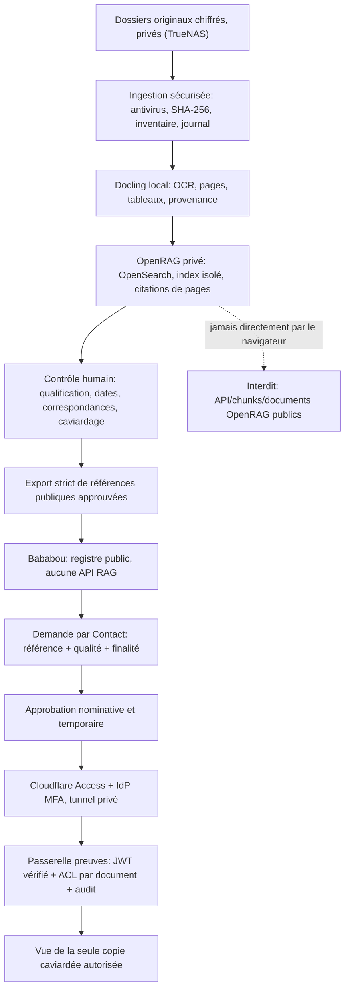

# NRE — registre public, preuves privées et architecture OpenRAG / Docling

**Statut au 8 novembre 2026 : préparation, sans publication de documents privés, sans connexion effective à OpenRAG.**

## Objectif et séparation de confiance

Le site `bababou.com` expose un **registre de déclarations** ; il ne doit **pas** servir d'extranet juridique ni exposer une base RAG. Le moteur documentaire prévu sur TrueNAS conserve les documents familiaux, décisions, plaintes, courriels, courriers et justificatifs, sous contrôle du propriétaire.

Le registre initial `data/nre-evidence.public.json` contient **quatre affirmations publiques attribuées au propriétaire** : démarches de contact répétées, plaintes déclarées en France, en Norvège et en Allemagne depuis le jugement de 2017. Il **ne** contient ni le nombre réel de plaintes, ni les dates exactes, ni les autorités saisies pour chaque démarche, ni un état de procédure non établi. **Zéro pièce privée liée** initialement. Le document français déjà présent ailleurs sur NRE ne devient pas automatiquement une preuve vérifiée dans ce nouveau registre : contrôler date, caviardage, droits et correspondance avant liaison.



## Modèle public actuel

`data/nre-evidence.public.json` est **intentionnellement limité** et validé par `lib/nrePublicEvidence.mjs`. Une clé non connue provoque une erreur. Aucune URL d'origine, chemin local, object key, hash d'original, extrait OCR, texte intégral, identifiant de personne ou jeton ne peut être ajouté au schéma.

Chaque entrée possède :
- `id` : identifiant stable non nominatif `NRE-CLAIM-*` ; **pas** un numéro officiel de plainte ;
- `kind` : `contact-request` ou `complaint` ;
- `jurisdiction` : `FR`, `NO`, `DE` ou `MULTI` (aucun quatrième pays déduit) ;
- `reportedSince` : date de référence déclarée (2017-03-31), **pas la date de chaque plainte** ;
- `eventDate: null` et `datePrecision: unknown` : abstention explicite tant que les dates n'ont pas été croisées ;
- `assertionStatus: owner-reported` : attribution, sans constat judiciaire ;
- `evidenceStatus: unlinked`, `publicProofRefs: []` : absence de rapprochement documentaire public.

Des références `NRE-PROOF-0001`... pourront être ajoutées **seulement après revue humaine** : titre public caviardé en quatre langues, pages utiles, identifiants des déclarations concernées, `publicationStatus: request-only`. Aucun lien direct au PDF privé n'est autorisé. Les titres eux-mêmes doivent passer la revue de confidentialité.

## Modèle privé à créer (hors GitHub / hors Vercel)

Pour chaque **pièce**, conserver dans une base chiffrée accessible au seul propriétaire et aux processus autorisés :

```json
{
  "privateEvidenceId": "<identifiant interne aléatoire>",
  "publicRef": "<facultatif, après revue>",
  "evidenceType": "complaint|judgment|contact-request|reply|delivery-proof|other",
  "country": "FR|NO|DE|other|unknown",
  "documentDate": null,
  "datePrecision": "exact|month|year|unknown",
  "authority": "<entité si vérifiée>",
  "proceduralReference": "<donnée privée jusqu'à revue>",
  "originalSha256": "<empreinte calculée localement>",
  "originalObjectKey": "<clé de stockage interne, jamais publiée>",
  "mimeType": "application/pdf",
  "pageCount": null,
  "doclingVersion": "<version exécutée>",
  "ingestedAt": "<horodatage UTC>",
  "classification": "restricted-family-evidence",
  "assertions": ["<identifiant de déclaration publique>"],
  "pageCitations": [{"page": 1, "reviewed": false}],
  "redactionState": "unreviewed",
  "ownerPublicationApproval": false,
  "accessClassification": "owner-only"
}
```

**Ce bloc est un contrat et non un dossier réel.** Le hachage préserve l'intégrité d'un original, sans démontrer à lui seul son authenticité ni la véracité des faits. Conserver original et copie de consultation distincts, avec version de caviardage et historique de validation. Pour des preuves de non-réponse, ne pas déduire la réponse à partir d'un silence dans OpenRAG : enregistrer aussi l'envoi, la réception et les recherches effectuées.

## Pipeline d'ingestion et règles de sécurité

1. Importer les documents **localement**, dans un espace restreint ; antivirus, contrôle MIME/poids, détection de doublons et empreinte SHA-256 de l'original. Aucune extraction vers une API LLM publique sans examen contractuel et consentement approprié.
2. Exécuter **Docling** en environnement isolé, idéalement hors réseau, pour OCR/tableaux/repères de pages. Ne jamais modifier l'original ; conserver les pages sources et un journal d'erreurs. Les sorties OCR/chunks **sont privées**.
3. Indexer dans **OpenRAG/OpenSearch interne**, dans un corpus séparé des données de démonstration et autres projets. Vérifier authentification, mode multi-utilisateur, sauvegarde/restauration, chiffrement au repos/en transit, contrôle des connecteurs et politiques d'index. Le mode **OpenRAG sans OAuth** décrit par l'éditeur n'offre **aucune séparation des utilisateurs** : **ne pas** partager son interface ou API avec les demandeurs.
4. Vérifier manuellement les résultats RAG contre l'original et ses pages. Le LLM ne peut ni attribuer une décision judiciaire, ni inventer une date, ni décider de publier. Considérer le contenu ingéré comme **non fiable** (prompt injection, instructions embarquées dans les PDF, HTML et courriels).
5. Après caviardage **irréversible**, revue légale et approbation du propriétaire, exporter **uniquement** le sous-ensemble de métadonnées publiques conforme au schéma. Publication par PR/Draft, privacy gate, revue de diff et approbation du propriétaire. Jamais de synchronisation directe et automatique OpenRAG → site public.

## Demande d'accès : parcours recommandé

- **Maintenant (statique, fermé)** : le visiteur indique la **référence publique** et sa qualité (avocat, autorité, association, autre) via le **Contact existant**. Ne pas demander d'envoi de pièces personnelles via un formulaire public. Aucune donnée documentaire privée n'est exposée.
- **Phase sécurisée** : activer une application **Cloudflare Access dédiée** (nom DNS privé à définir), politique `Deny` implicite, identité vérifiée par IdP et **MFA exigée** (passkey/FIDO2 recommandé). Prévoir **Purpose Justification** et **Temporary authentication** avec approbation manuelle du propriétaire à chaque session.
- **Après approbation** : une **passerelle documentaire** distincte vérifie cryptographiquement le JWT Access (émetteur, audience, signature, expiration, identité) **et** une autorisation locale `subject → publicProofRefs → rendition`, limitée dans le temps (ex. 15 minutes), à lecture seule. L'accès à Access **n'est jamais** une autorisation globale à tous les documents.
- **Remise** : privilégier une visualisation proxy de **copies caviardées approuvées**, `Cache-Control: private, no-store`, `X-Robots-Tag: noindex, noarchive`, `Referrer-Policy: no-referrer`, politique CSP stricte ; aucune URL brute de stockage ou d'OpenRAG. Journaliser identifiant du demandeur, approbateur, référence, version de copie et horodatage, sans conserver le contenu ou le jeton dans les logs.
- **Fin/retrait** : expirer et révoquer la permission serveur ; invalider les sessions si nécessaire. Une copie déjà téléchargée ne peut pas être techniquement récupérée : limiter les exportations, tracer la divulgation et mentionner cette limite dans l'accord d'accès.
- **Interdiction** : ne jamais mettre un token `OPENRAG_API_KEY`, un lien signé d'objet, une URL TrueNAS, des chunks vectoriels, des originaux ou des données de mineur dans `NEXT_PUBLIC_*`, Vercel, le code client, le HTML public ou les logs de CI. Une URL pré-signée est un **bearer token** réutilisable jusqu'à expiration : à éviter pour les pièces les plus sensibles.

### Contrats API futurs (non implémentés)

```text
POST /v1/access-requests
  { publicRef, justification, requesterIdentity }
  -> 202 (pending_owner_approval)

POST /v1/grants/{requestId}/approve   # owner + MFA + audit, jamais côté navigateur public
  { allowedPublicRefs, approvedRenditions, expiresAt }
  -> 204

GET /v1/evidence/{publicRef}/view
  Access JWT + grant serveur, ACL à chaque requête
  -> 200 (copie caviardée) / 401 / 403 / 404 / 410

POST /v1/grants/{grantId}/revoke
  -> 204
```

**Aucun de ces endpoints ne doit être créé sur le site statique avant d'avoir déployé la passerelle privée et testé les refus.** Utiliser un compte service à privilèges minimaux entre passerelle et OpenRAG ; ne pas réutiliser le compte administrateur du backend.

### Critères de GO / NO-GO avant diffusion d'une seule pièce

- [ ] Rôles et personnes autorisées définis, documents approuvés individuellement, durée et finalité explicites.
- [ ] Pas d'accès anonyme ou transversal aux corpus OpenRAG ; audit du mode réel (OAuth/tenant/ACL).
- [ ] Validité des JWT `iss/aud/exp/signature`, test de contournement direct de l'origine/Tunnel.
- [ ] Tests `401` sans session, `403` autre pièce, `410` après révocation/expiration et échec par défaut.
- [ ] Caviardage irréversible vérifié dans le PDF et ses métadonnées, pas seulement à l'écran.
- [ ] Index et journaux purgés des versions mal classifiées, sauvegardes chiffrées, droits de restauration documentés.
- [ ] Revue des données de mineur, confidentialité, base légale et nécessité/proportionnalité de la communication.
- [ ] Tests contre prompt injection, SSRF, injection HTML, exfiltration de chunks, enumeration d'IDs, cache/CDN, accès croisé.
- [ ] Procédure de retrait, journal d'approbation et validation humaine avant toute copie communicable.

## Références techniques (consultées le 8 novembre 2026)

- [OpenRAG — architecture Langflow + OpenSearch + Docling](https://docs.openr.ag/)
- [OpenRAG — modes d'authentification de la base documentaire](https://docs.openr.ag/knowledge/)
- [OpenRAG — API SDK et MCP](https://docs.openr.ag/reference/api-sdk-overview/)
- [Docling — formats et extraction de provenance](https://docling.ai/formats/)
- [Cloudflare Access — application self-hosted et validation du JWT](https://developers.cloudflare.com/cloudflare-one/access-controls/applications/http-apps/self-hosted-public-app/)
- [Cloudflare Access — authentification temporaire et approbation](https://developers.cloudflare.com/cloudflare-one/access-controls/policies/temporary-auth/)
- [Cloudflare Access — MFA](https://developers.cloudflare.com/cloudflare-one/access-controls/policies/mfa-requirements/)
- [Cloudflare R2 — avertissements sur les URL pré-signées](https://developers.cloudflare.com/r2/api/s3/presigned-urls/)

**Les options et caractéristiques ci-dessus sont des exigences d'architecture proposées ; aucune configuration TrueNAS, Cloudflare, OpenRAG, Docling, Vault ou connexion distante n'a été modifiée.**
